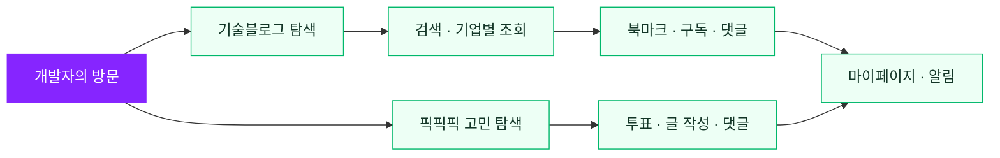
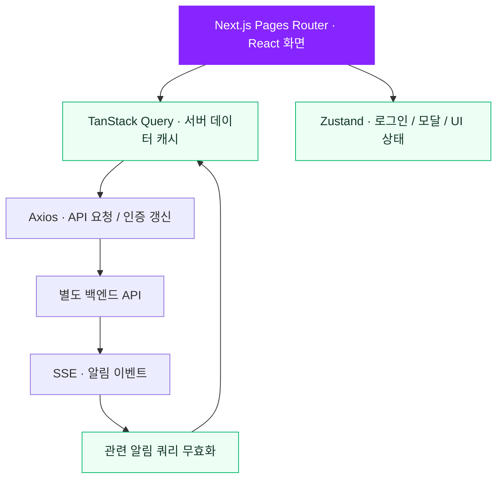

<p align="center">
  
</p>

<h1 align="center">댑댑댑 · DEVDEVDEV</h1>

> **서비스 운영 종료 안내**
> 댑댑댑은 **2026년 1월 21일** 운영을 종료했습니다. 이 저장소는 프로젝트의 구현 내용을 확인할 수 있도록 보관하고 있습니다.

<p align="center">
  <strong>기술 아티클을 발견하고, 개발 고민을 함께 해결하는 개발자 커뮤니티</strong><br />
  국내 기업 기술블로그 큐레이션부터 두 가지 선택지의 개발 고민 투표까지
</p>

<p align="center">
  <a href="https://devdevdev.co.kr">기존 서비스 주소</a> ·
  <a href="#주요-기능">주요 기능</a> ·
  <a href="#구현-포인트">구현 포인트</a> ·
  <a href="#로컬-실행">로컬 실행</a>
</p>

<p align="center">
  
  
  
  
  
</p>

## 프로젝트 한눈에 보기

| 무엇을 만드는 프로젝트인가요? | 어떤 경험을 제공하나요? |
| --- | --- |
| **개발자를 위한 정보 탐색·의견 공유 서비스** | 여러 기업의 기술 아티클을 한곳에서 찾고, 개발 고민을 투표와 댓글로 나눕니다. |
| **Next.js 기반 웹 프론트엔드** | 기술블로그·투표·내 활동·구독 알림을 하나의 서비스로 연결합니다. |
| **모바일·데스크톱 대응 UI** | 반응형 화면과 라이트·다크 테마를 제공합니다. |

## 주요 기능

| 🧪 기술블로그 | 💘 픽픽픽 | 🔔 내 활동·구독 |
| --- | --- | --- |
| 기업별 아티클 탐색 | 두 가지 선택지의 개발 고민 투표 | 내가 작성한 픽·댓글 확인 |
| 키워드 검색·정렬·무한 스크롤 | 게시글 작성·수정·삭제·이미지 업로드 | 북마크·구독 기업 관리 |
| 북마크·추천·댓글·답글 | Markdown 콘텐츠·댓글·추천·유사 픽 | 알림 확인·닉네임 변경·회원 탈퇴 |



로그인은 카카오 계정으로 진행합니다. 로그인과 데이터 저장 등 서버 연동 기능에는 별도 백엔드가 필요하며, 이 저장소는 프론트엔드 구현을 다룹니다.

## 구현 포인트

아래 항목은 현재 코드에서 확인할 수 있는 구현입니다. 파일 링크를 통해 데이터 처리와 화면 구성을 살펴볼 수 있습니다.

| 구현 주제 | 적용 방식 | 관련 코드 |
| --- | --- | --- |
| **검색·목록 데이터 흐름** | 검색어 유무에 따라 기본 피드와 검색 피드를 전환하고, 화면에는 공통 형태의 데이터·로딩 상태를 제공 | [useUnifiedPickFeed](pages/pickpickpick/api/useUnifiedPickFeed.ts) |
| **무한 스크롤·캐시** | 검색·정렬·기업 조건을 쿼리 키로 분리하고, 커서 기반 다음 페이지 요청과 IntersectionObserver를 연결 | [useInfiniteTechBlog](pages/techblog/api/useInfiniteTechBlog.ts) |
| **서버 상태·UI 상태 관리** | TanStack Query로 서버 데이터를 관리하고, Zustand로 로그인·모달 등 클라이언트 상태를 관리 | [앱 Provider](pages/_app.page.tsx) · [stores](stores) |
| **인증 만료 대응** | Axios 인터셉터에서 만료 응답을 감지해 토큰 갱신 후 기존 요청을 재시도 | [useSetAxiosConfig](api/useSetAxiosConfig.tsx) |
| **알림 갱신** | 로그인 상태에 따라 SSE를 연결·해제하고, 이벤트 수신 시 관련 알림 쿼리를 무효화 | [useAlertSSE](hooks/useAlertSSE.ts) |
| **오류·재시도 UI** | Query 오류를 Error Boundary로 처리하고 Sentry 기록 및 재시도 동작을 연결 | [QueryErrorBoundary](components/common/QueryErrorBoundary.tsx) |
| **반응형·테마** | 공통 미디어 쿼리 컨텍스트로 화면을 분기하고 next-themes로 테마를 적용 | [MediaQueryContext](contexts/MediaQueryContext.tsx) · [앱 Provider](pages/_app.page.tsx) |

### 프론트엔드 구조



## 기술 스택

| 구분 | 사용 기술 |
| --- | --- |
| 프레임워크 | Next.js 14.0.4 · React 18 · TypeScript 5 |
| 라우팅 | Pages Router (`*.page.tsx`) |
| 스타일·인터랙션 | Tailwind CSS 3 · Framer Motion · next-themes · Swiper |
| 데이터 통신·캐시 | Axios · TanStack Query 5 |
| 클라이언트 상태 | Zustand 4 |
| 폼·에디터 | React Hook Form · Toast UI Editor |
| 테스트 | Jest 29 · Testing Library · MSW 2 |
| 운영 연동 | Sentry · Google Analytics · Channel.io · Google AdSense |
| CI·배포 | GitHub Actions · Vercel |

버전은 `package.json` 기준이며, 설치 의존성은 `pnpm-lock.yaml`에 기록되어 있습니다.

## 로컬 실행

<details>
<summary>개발 환경 및 실행 방법 펼치기</summary>

### 1. 준비 및 설치

- Node.js **22.x**: `package.json`의 `engines.node` 기준
- pnpm: 잠금 파일 형식 `9.0`을 지원하는 버전 사용. 저장소에 pnpm 버전은 별도로 고정되어 있지 않습니다.

```bash
git clone https://github.com/dreamyPatisiel/devdevdev-client.git
cd devdevdev-client
pnpm install --frozen-lockfile
```

### 2. 환경 설정

서비스 운영이 종료되어 실제 데이터 조회와 로그인에는 별도의 개발용 백엔드 및 OAuth 설정이 필요합니다. 이 저장소만으로 전체 서비스를 재현할 수는 없습니다.

백엔드를 연결하는 경우 프로젝트 루트의 `.env.local`에 다음 값을 설정합니다.

```dotenv
NEXT_PUBLIC_SERVICE_URL=<개발용 백엔드 기본 URL>
NEXT_PUBLIC_OAUTH_REDIRECT_ENDPOINT=<백엔드 로그인 경로>
```

- `NEXT_PUBLIC_SERVICE_URL`: 백엔드 기본 URL. API 코드에 `/devdevdev/api/v1/...` 경로가 포함되어 있으므로 경로가 중복되지 않게 설정합니다.
- `NEXT_PUBLIC_OAUTH_REDIRECT_ENDPOINT`: 로그인 팝업 주소를 구성하는 백엔드 경로. 서비스 URL 뒤에 연결됩니다.

실제 로그인에는 백엔드의 OAuth·CORS·쿠키 설정도 필요합니다. `.env.local`은 Git에서 제외되며, `NEXT_PUBLIC_` 변수는 브라우저에 노출되므로 비밀값을 넣지 않습니다. 환경 설정을 바꾼 후 개발 서버를 다시 시작합니다.

### 3. 개발 서버 실행

```bash
pnpm dev
```

[http://localhost:3000](http://localhost:3000)에 접속하면 `/main`으로 이동합니다.

### 개발 모드의 모의 API

`pages/_app.page.tsx`에서 프로덕션이 아닌 환경에 MSW를 자동으로 로드합니다. 등록된 핸들러는 다음과 같습니다.

- 기술블로그 목록: `/devdevdev/api/v1/articles`
- 픽 목록 모의 데이터: `/pickData`
- 카카오 인증 요청: `https://kauth.kakao.com/oauth/authorize`

모든 기능을 모의 데이터로 제공하는 구성은 아닙니다. 실제 픽 API와 `/pickData`는 서로 다르며, 상세 조회·투표·작성·구독·알림 등에는 백엔드 연동이 필요합니다. 처리되지 않은 요청은 네트워크로 전달되며 콘솔에 경고가 표시됩니다. 실제 API 연동을 점검할 때는 MSW 등록 여부와 요청 주소를 함께 확인하세요.

### 실행 명령

| 명령 | 설명 |
| --- | --- |
| `pnpm dev` | 개발 서버 실행 |
| `pnpm build` | 프로덕션 빌드 |
| `pnpm start` | 빌드 결과로 프로덕션 서버 실행 (`pnpm build` 선행) |
| `pnpm lint` | Next.js ESLint 검사 |
| `pnpm test` | Jest 테스트 실행 |
| `pnpm test:watch` | 변경을 감지하며 테스트 실행 |

프로덕션 모드에서는 개발용 MSW가 자동으로 로드되지 않습니다.

</details>

## 디렉터리 구조

<details>
<summary>디렉터리 구조 펼치기</summary>

```text
.
├── pages/              # 화면 및 화면별 컴포넌트·API 훅·타입
│   ├── main/           # 홈
│   ├── techblog/       # 기술블로그 목록·상세
│   ├── pickpickpick/   # 픽 목록·상세·수정
│   ├── pickposting/    # 픽 작성
│   └── myinfo/         # 내 활동·구독·알림·계정 관리
├── components/         # 공통 UI 및 기능별 컴포넌트
├── api/                # 공통 API 훅, 인증 요청 설정
├── core/               # Axios 인스턴스
├── hooks/              # 공통 훅, SSE 알림 연결
├── stores/             # Zustand 상태
├── contexts/           # 반응형 미디어 쿼리 컨텍스트
├── constants/          # 경로·메타데이터·UI 상수
├── types/              # 공통 타입
├── utils/              # 쿠키 등 유틸리티
├── lib/                # Google Analytics 연동
├── styles/             # 전역 스타일
├── public/             # 이미지·폰트·MSW 서비스 워커
├── _tests_/            # 테스트, MSW 핸들러·모의 데이터
└── .github/workflows/  # 빌드·린트·테스트·배포 워크플로
```

페이지 파일은 `next.config.js`의 `pageExtensions` 설정에 따라 **`.page.tsx`** 확장자를 사용합니다. 경로 별칭은 `tsconfig.json`에서 관리하며, `@/`는 프로젝트 루트를 가리킵니다.

</details>

## 주요 화면 경로

<details>
<summary>화면 경로 펼치기</summary>

| 경로 | 화면 |
| --- | --- |
| `/main` | 홈 (`/`에서 리다이렉트) |
| `/techblog` · `/techblog/[id]` | 기술블로그 목록·상세 |
| `/pickpickpick` · `/pickpickpick/[id]` | 픽 목록·상세 |
| `/pickposting` · `/pickpickpick/modify/[id]` | 픽 작성·수정 |
| `/myinfo/mywriting/mypick` | 내가 작성한 픽 |
| `/myinfo/mywriting/mycomment` | 내가 작성한 댓글 |
| `/myinfo/bookmark` | 북마크 |
| `/myinfo/notifications/notification` | 알림 목록 |
| `/myinfo/notifications/subscribe` | 구독 기업 |
| `/myinfo/account-delete` | 회원 탈퇴 |

</details>

## 테스트 및 배포

Jest와 Testing Library로 버튼·로그인 관련 테스트를 구성하고, MSW로 일부 네트워크 요청을 모의 처리합니다. 테스트 설정은 `jest.config.js`, 공통 설정은 `_tests_/setupTests.ts`에 있습니다. CI에서는 `jest-fixed-jsdom` 환경을 사용합니다.

GitHub Actions는 PR 생성·업데이트 시 빌드, 린트, 테스트를 실행합니다. 현재 이 워크플로들은 Node.js 20을 사용하므로 로컬 권장 버전인 `engines.node`의 22.x와 차이가 있습니다.

`main` 브랜치에 push하면 Vercel 배포 워크플로가 실행됩니다. 배포에는 저장소의 `PERSONAL_ACCESS_TOKEN`, `VERCEL_TOKEN`, `VERCEL_ORG_ID`, `VERCEL_PROJECT_ID` 시크릿과 별도의 런타임 환경 설정이 필요합니다.
